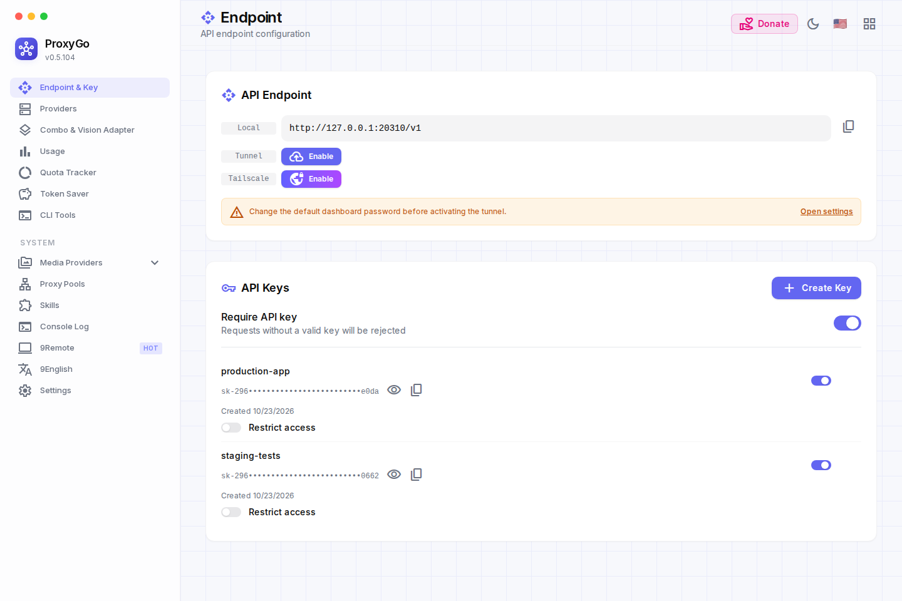
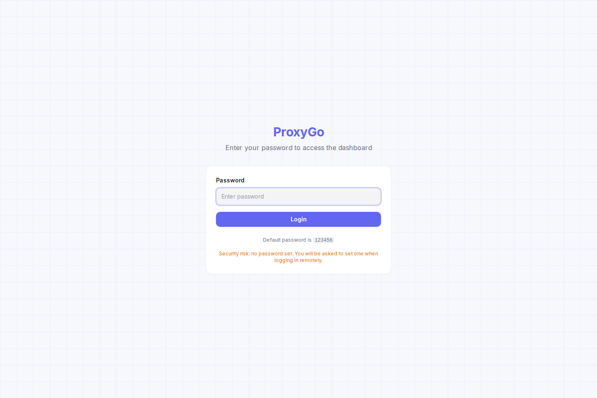
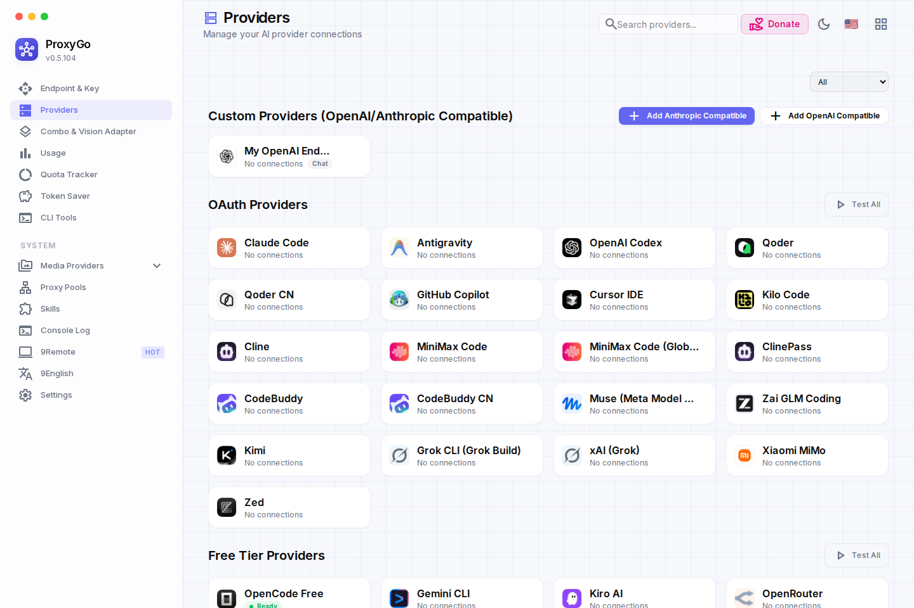
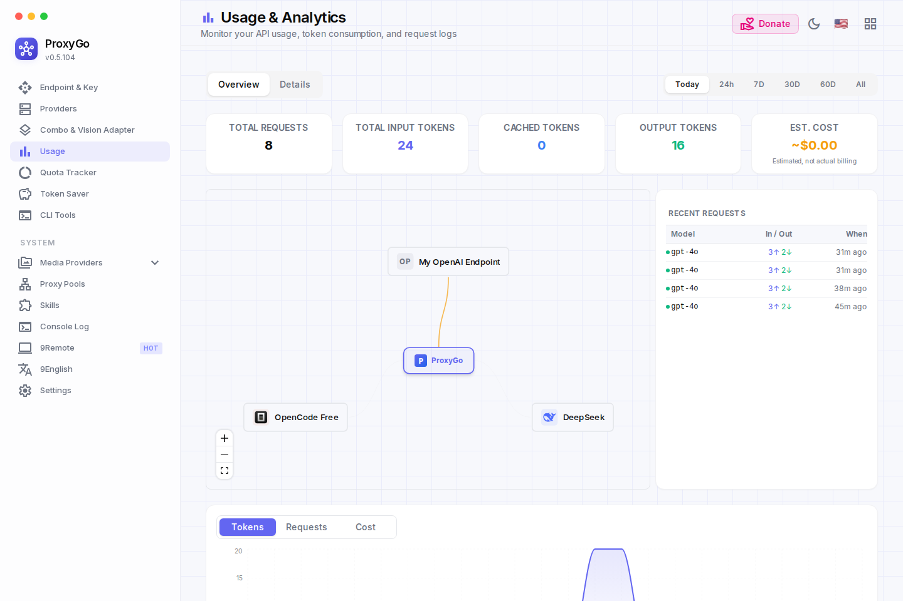
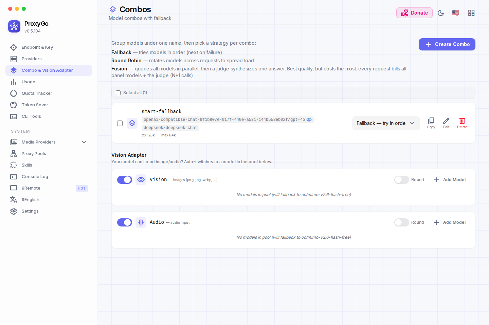
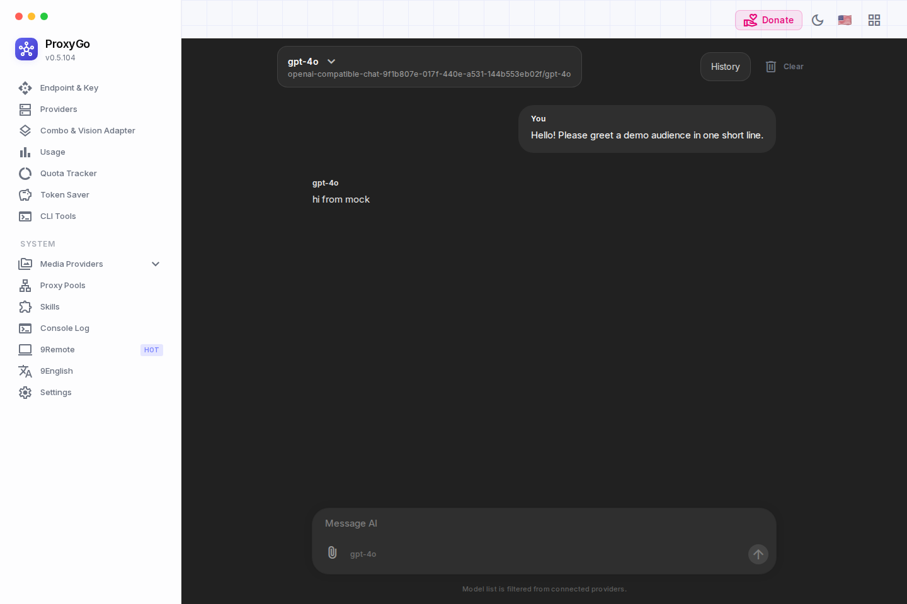
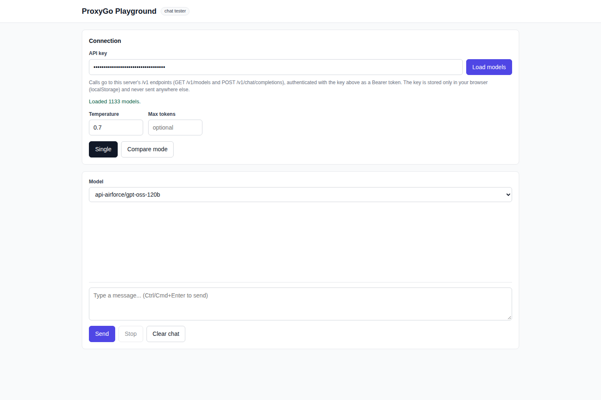
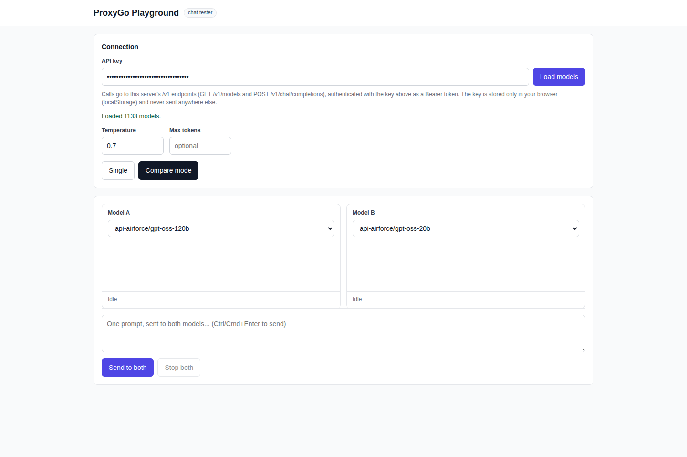

# ProxyGo

**ProxyGo** is the Go port of [9Router](https://github.com/decolua/9router)
v0.5.104, rebranded end to end (name, indigo identity, CLI, env vars,
headers) — everything below describes the ProxyGo build.

A complete Go port of [9Router](https://github.com/decolua/9router)
v0.5.104: the AI router that fronts 100+ providers behind one
OpenAI-compatible endpoint. The Go backend is a single static binary;
the original React dashboard is kept as-is and served by the Go
server as static files.

Every screenshot below is a real capture of this Go build running
with its dashboard — no mockups.



## Screenshots

**Login** — password gate for the dashboard (default password
`123456` on first run; you are asked to change it).



**Providers** — 137 provider definitions: OAuth tools (Claude Code,
Codex, Copilot, Cursor, Kiro…), API-key providers, free tiers, and
custom OpenAI/Anthropic-compatible endpoints with live model
discovery.



**Usage & analytics** — every request is recorded (tokens, cost,
latency, request details) and charted per provider, model and key.



**Combos** — group models under one name with fallback, round-robin
or fusion strategies, plus the vision/audio capacity adapters.



**Basic Chat** — a built-in chat client on top of your own routed
models, streaming included.



**Playground** (`/playground`, Go addition) — test any of the 1,133
models with your API key, watch latency and token stats per reply…



…or race two models side by side in compare mode and see the winner
by speed and by tokens.



## Run it

```bash
go build -o proxygo ./cmd/proxygo
PORT=20128 ./proxygo
```

```powershell
# Windows (PowerShell)
go build -o proxygo.exe .\cmd\proxygo
$env:PORT=20128; .\proxygo.exe
```

- Dashboard + API on the same port. Point `WEB_DIR` at a built
  dashboard directory to serve the React UI (without it the server
  still answers the full API surface plus `/playground`).
- Data lives in SQLite at `$DATA_DIR/db/data.sqlite`
  (default `~/.proxygo`), schema-compatible with the original
  `src/lib/db`; a legacy `db.json` is imported once, automatically.
- First-run shortcut: start with `UPSTREAM_API_KEY=sk-...` to seed
  an `openai` connection on an empty database.
- API surface: `GET /health`, `GET /v1/models`,
  `POST /v1/chat/completions` · `/v1/messages` · `/v1/responses`,
  plus the full dashboard API under `/api/*`.
- Custom endpoints work exactly like the original: create an
  `openai-compatible-*` / `anthropic-compatible-*` node, add a
  connection, and its models are discovered live from the endpoint.

CLI companion (`cmd/proxygo-cli`): start/stop/status/open,
connect CLI tools (Claude Code, Codex, Copilot, Cline…), `show`,
`xai video`, `update`, and a Windows system tray.

## What was ported

| Area | Coverage |
|---|---|
| Provider registry | 137/137 providers, 1,133 models, aliases |
| Model catalog + pricing | 1,155 entries / 112 providers, wired into cost accounting |
| Translators | OpenAI ↔ Claude / Gemini / Responses, Kiro (all directions), Cursor — request, body and stream |
| Database | Real SQLite (pure Go, no cgo), 11 tables / 11 repos, `db.json` import |
| Executors | Default + all special executors incl. Kiro EventStream, Bedrock SigV4, Cursor HTTP/2 + hand-rolled protobuf, and all 14 bespoke web/session executors |
| Chat core | Account/combo fallback, cooldowns, token refresh, SSE, RTK token saver, usage recording, request details |
| Dashboard API | Auth/settings/keys/pricing/version, providers/nodes/combos/models/tags/proxy-pools (with Cloudflare/Deno/Netlify/Vercel deploys), usage/translator/media/MCP/headroom/pxpipe/tunnel ops |
| OAuth / SSO | Engine for 28 providers (auth-code, device-code, refresh), OIDC (PKCE + JWKS), SAML with real XMLDSig signature verification |
| Tunnels / MITM | Cloudflare quick tunnels, Tailscale; root CA + TLS intercept incl. the Kiro intercept |
| Per-provider usage fetchers | 29/29 ported |

## Feature Pack 1+3 (Go-only additions)

All opt-in via dashboard settings, default off, zero behavior change
when off:

- **Response cache** — byte-level replay (SSE included), LRU + TTL,
  `x-proxygo-no-cache: 1` bypass, `GET /api/cache/stats`,
  `POST /api/cache/clear`
- **Circuit breaker** — per-connection failure threshold with
  half-open probing, `GET /api/breaker/stats` (HTTP 429 counts as
  healthy; it is a rate limit, not an outage)
- **Per-key limits** — RPM plus daily/monthly token and cost budgets
  per API key (`/api/keys/{id}/limits`), fail-open by design
- **Playground** — embedded at `/playground`, single + compare mode
- **Self-update** — checksum-verified binary swap from GitHub
  Releases (dashboard action and `proxygo-cli update`); activates
  when a release publishes `proxygo-<os>-<arch>` assets
- **PII redaction** — emails, phone numbers, Luhn-validated cards
  and API keys are masked before prompts leave the server; national
  IDs behind a separate opt-in
- **Windows tray** — hand-rolled `Shell_NotifyIcon` tray
  (Open Dashboard / Start / Stop / Quit), no cgo

Two completions go beyond the upstream source: usage recording is
wired through the whole chat pipeline (upstream records via the
same stores), and `POST /api/dashboard/chat/completions` — the route
the Basic Chat page calls, which upstream v0.5.104 ships without a
server handler — is implemented here (dashboard-session auth, runs
under your first active API key).

## Verification

- `go vet ./...` clean; `go test ./...` — **all 20 packages PASS**
- `GOOS=windows go build ./...` green (server + CLI + tray)
- Live-smoke tested end to end: login flow, 1,133 models, keys
  CRUD, OAuth authorize URLs, a real per-provider usage fetch,
  pxpipe child-process status/health, and every Feature Pack
  behavior (cache hit replay, redacted upstream body, 429 over the
  RPM limit, breaker circuit open) against a mock upstream
- 222 Go files · ~102,800 lines of Go incl. ~16,700 lines of tests ·
  ~25 MB server binary

## Known residuals

- The Windows tray is compile-verified but has not yet run on a
  real Windows desktop (no GUI environment here).
- The 14 web executors, Cursor and SAML are verified against
  protocol fixtures generated from the original JS — not against
  live provider accounts / a real IdP.
- pxpipe runs for real as a child process; its transform is not
  routed through the Go chat pipeline.
- Per-connection proxy options are not applied inside the usage
  fetchers / AutoPing.
- Desktop credential extraction with no Go equivalent: Xiaomi MiMo
  passToken from the desktop cookie DB, Zed Windows Credential
  Manager, Bedrock profile-mode credentials — static keys work
  everywhere.

## Rebrand notes (9Router → ProxyGo)

- The default data directory moved from `~/.9router` to
  `~/.proxygo` — existing installs should move the folder or set
  `DATA_DIR`. Env vars are `PROXYGO_*`; CLI tool configs written by
  the connect flow use the `proxygo` provider key.
- A handful of wire identifiers deliberately keep the old name —
  the SAML entityID `urn:9router:sp`, the API-key HMAC fallback
  secret, the MITM password-encryption salt, and a few
  provider-registered client tokens (`X-Msh-Platform`,
  `X-CLIENT-TYPE`, the xAI referrer) — because renaming them would
  invalidate existing IdP registrations, already-issued API keys,
  stored credentials, or provider allowlists. They are invisible
  in the UI; see `docs/REBRAND_PROXYGO.md` for the full contract.

## Docs

- `docs/CONVERSION_PLAN.md` — the port plan, directory by directory
- `docs/GO_CONTRACT.md` / `docs/PHASE2_CONTRACT.md` — package
  contracts used during the port
- `docs/FEATURE_PACK_13.md` — Feature Pack 1+3 design
